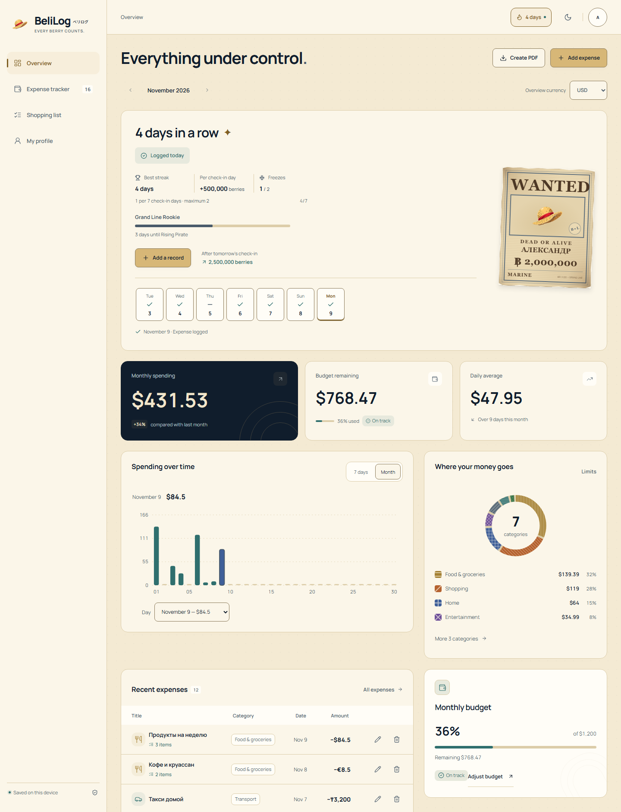
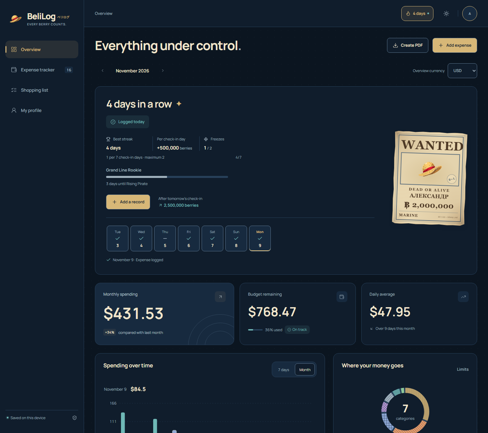
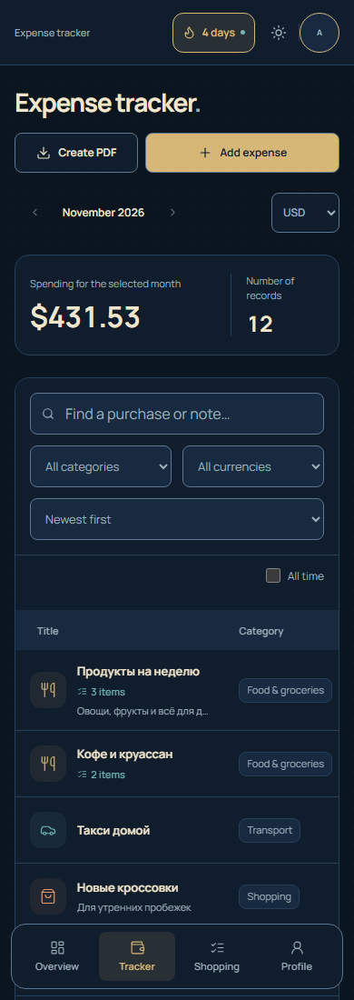

# BeliLog (ベリログ)

**Every Berry Counts.** A local-first expense tracker with a pirate-inspired identity.

[Open BeliLog](https://riokoqee.github.io/belilog/) · [Русский](README.ru.md)

## Preview

<table>
  <tr><th>Light</th><th>Dark</th><th>Mobile</th></tr>
  <tr>
    <td><a href="docs/screenshots/desktop-light.png"></a></td>
    <td><a href="docs/screenshots/desktop-dark.png"></a></td>
    <td><a href="docs/screenshots/mobile.png"></a></td>
  </tr>
</table>

## What it does

- Expenses, purchase details, monthly budgets and category limits.
- Shopping lists with prices, purchase confirmation and reusable templates.
- USD, EUR and KZT with manual rates; Russian and English; light, dark and system themes.
- No-spend check-ins, streak freezes and a personal WANTED poster.
- PDF reports, CSV export and full PDF/JSON backups.

Data stays in this browser, including after you close the site. There is no account or automatic device sync. Download a full backup before clearing browser data.

## Run locally

Requires Node.js 22.12+ or 24 LTS.

```bash
npm ci
npm run dev
```

Production build and unit tests:

```bash
npm run build
npm test
```

React 19 · TypeScript · Vite. Static hosting through GitHub Pages.

## Documentation

- [User guide in Russian](docs/USAGE.ru.md)
- [Development, browser tests and deployment](docs/DEVELOPMENT.md)
- [Streaks and freezes](docs/STREAKS.md)
- [Design](docs/DESIGN_REDESIGN.md) and [performance](docs/PERFORMANCE.md)
- [Asset sources and license notices](docs/ASSETS.md)

## License

Application source: [MIT](LICENSE). Artwork, fonts and dependency notices are listed separately in [ASSETS.md](docs/ASSETS.md).
