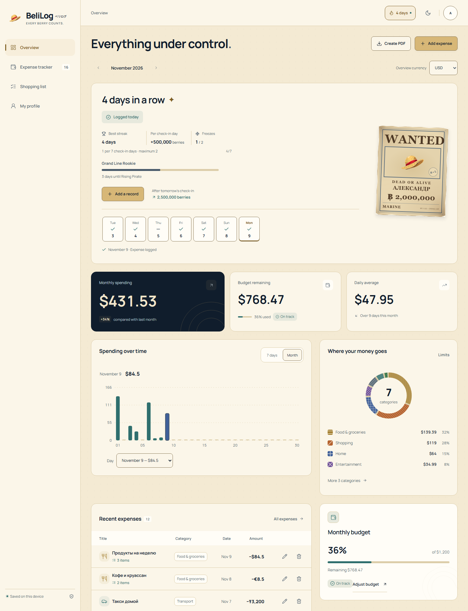
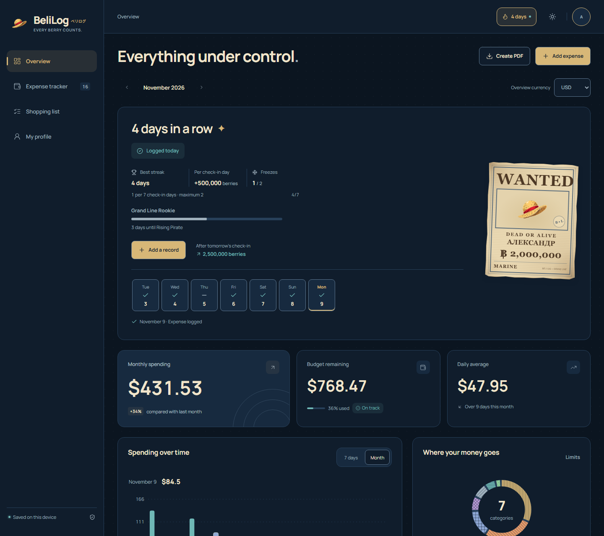
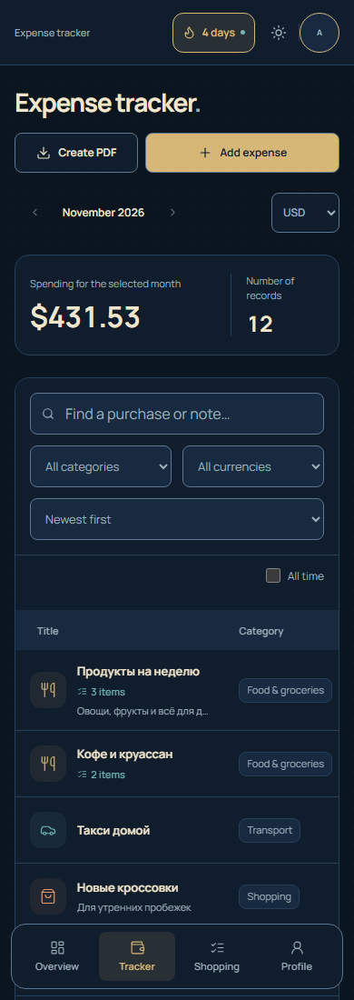

# BeliLog (ベリログ)

[](https://github.com/riokoqee/belilog/actions/workflows/pages.yml) [](LICENSE) [](https://github.com/riokoqee/belilog/releases/latest)

**Every Berry Counts.** Личный журнал расходов с локальным сохранением и пиратским характером.

[Открыть BeliLog](https://riokoqee.github.io/belilog/) · [English](README.md)

## Как выглядит

<table>
  <tr><th>Светлая</th><th>Тёмная</th><th>На телефоне</th></tr>
  <tr>
    <td><a href="docs/screenshots/desktop-light.png"></a></td>
    <td><a href="docs/screenshots/desktop-dark.png"></a></td>
    <td><a href="docs/screenshots/mobile.png"></a></td>
  </tr>
</table>

## Возможности

- Расходы с составом покупки, месячный бюджет и лимиты категорий.
- Список покупок с ценами, подтверждением покупки и шаблонами.
- USD, EUR и KZT: ручные курсы по умолчанию, ежедневное обновление Frankfurter по желанию.
- Установка как PWA, страницы и экспорт PDF без сети после подготовки; русский и английский, три темы.
- Дни без трат, заморозки серии и персональный постер WANTED.
- PDF-отчёты, экспорт CSV и полные резервные копии PDF/JSON.

Данные остаются в этом браузере после закрытия сайта. Аккаунта и автоматической синхронизации между устройствами нет. Перед очисткой браузера скачайте полную резервную копию.

Для установки откройте **Профиль → Приложение** или меню установки браузера. Дождитесь статуса **«Готово офлайн»** перед отключением сети. Обновления применяются после закрытия всех вкладок BeliLog и повторного открытия.

## Локальный запуск

Нужен Node.js 22.12+ или 24 LTS.

```bash
npm ci
npm run dev
```

Сборка и модульные тесты:

```bash
npm run build
npm test
```

React 19 · TypeScript · Vite. Статический сайт на GitHub Pages.

## Документация

- [Подробное руководство](docs/USAGE.ru.md)
- [История изменений](CHANGELOG.md) и [релизы](https://github.com/riokoqee/belilog/releases)
- [Разработка, браузерные тесты и публикация](docs/DEVELOPMENT.md)
- [Серии и заморозки](docs/STREAKS.md)
- [Дизайн](docs/DESIGN_REDESIGN.md) и [производительность](docs/PERFORMANCE.md)
- [Источники изображений и лицензии](docs/ASSETS.md)

## Лицензия

Код приложения: [MIT](LICENSE). Изображения, шрифты и уведомления зависимостей перечислены отдельно в [ASSETS.md](docs/ASSETS.md).
